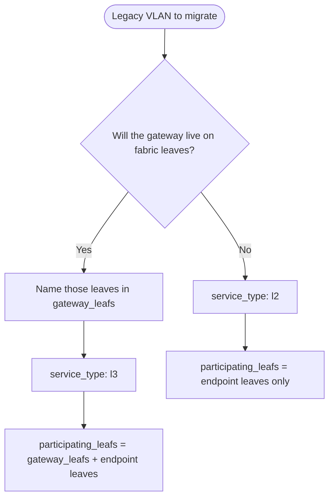

# VXLAN service types (L2 vs L3)

How to choose `service_type` (`l2` or `l3`) when migrating a legacy VLAN to VXLAN/EVPN on Arista EOS.

This field is required on every VLAN record under `vars/vlans/<dc>/`. It says where the **gateway** will live after migration. It does not describe how many leaves learn endpoints.

`l2_l3` is deprecated. Endpoint VLAN presence on additional leaves is normal EVPN placement (`participating_leafs`), not a separate stretch type.

---

## Summary

| `service_type` | Gateway after migration | What the fabric does |
|---|---|---|
| `l2` | Stays **outside** the VXLAN fabric | Layer-2 transport only |
| `l3` | Hosted **inside** the VXLAN fabric: every participating leaf (default) or the `gateway_leafs` pair | L2 VNI plus the gateway (distributed or centralized) |

`gateway_leafs` are named by the engineer. Discovery never copies a legacy SVI into that list. A discovered SVI is a **source gateway** (today's MLS or aggPE). That device is the root of the legacy L2, so it is prune-eligible unless it also has local endpoints or the engineer named it in `gateway_leafs`.

A border-leaf pair plus the leaves that host endpoints is a normal L3 migration. Example: gateway on `cma01-blf01` and `cma01-blf02`, endpoints on `fntc-aggacc-sw05` and `fntc-aggacc-sw06`. The type is `l3`. Participating leaves are the border leaves plus the two endpoint switches. Gateway leaves are the border leaves only.

---

## L2 (`service_type: l2`)

The gateway remains outside the fabric (firewall, router, or another device you are not moving into VXLAN). The fabric extends the broadcast domain.

- `participating_leafs` are the VTEPs that need the L2 VNI because they attach local endpoints.
- `gateway_leafs` stays empty.
- Do not create an L3 VNI for this VLAN.

---

## L3 (`service_type: l3`)

The gateway moves into the fabric. `gateway_mode` defaults to `distributed_anycast`: every participating leaf hosts the anycast SVI. For `centralized_anycast` the gateway sits on a leaf pair named in `gateway_leafs`, and those leaves also get the VLAN.

```yaml
service_type: l3
gateway_mode: centralized_anycast   # or distributed_anycast
gateway_leafs:
  - cma01-blf01
  - cma01-blf02
```

| `gateway_mode` | Meaning |
|---|---|
| `distributed_anycast` (default) | Every participating leaf (plus any named gateway leaf) hosts the anycast gateway |
| `centralized_anycast` | A leaf pair, named in `gateway_leafs`, hosts the anycast gateway. Discovery flags any other count |

Discovery recommends the type. An active SVI on the legacy MLS means `l3`: that gateway must be rebuilt in the fabric. No active SVI on a discovered switch means `l2`: the gateway is external (usually a firewall), and the report lists the ports that face it. For a probe record the recommendation becomes the type. For a DB record the record wins, and a disagreement is an action item.

Set `vrf` to the target VRF. The VLAN VNI is `evpn.l2.vni`. When it is empty, discovery proposes the next free one from the DC's range; the L3 VNI is the VRF's and is never used for the VLAN. Each VTEP gets the VLAN name taken from discovery (`show vlan`), `vxlan vlan <id> vni`, and `router bgp / vlan <id>` with `rd <router-id>:<vlan>` and `route-target both <l2 vni>:<vlan>` (both DCs; `evpn.l2.rt` overrides it). The gateway leaves (every participating leaf for `distributed_anycast`, the `gateway_leafs` pair for `centralized_anycast`) also get the SVI (`vrf`, `ip address virtual`, jumbo MTU) and `router bgp / vrf / network` for the VLAN prefix. The `network` statement is under that VRF, beside the `vlan` block, and the SVI is in the same VRF. A non-gateway VTEP gets the VLAN name, the VXLAN VNI, and the BGP VLAN block only. The VRF name and the SVI description come from the previous gateway. If discovery does not find the VLAN name, that description, or one agreed VRF, the deploy run asks for it. The VRF itself is not created (`cvp_build_borderleaf_config` defaults to `false`); when a leaf lacks the VRF's L3 VNI, the report's action items say to create it there first. BUM is head-end replication, already on the VTEPs. Do not set `mcast_group`.

---

## Where the VLAN must exist

| List | Meaning |
|---|---|
| `participating_leafs` | Deploy the VNI here. VTEPs only: gateway leaves, VTEPs with local endpoints, and VTEPs a non-VTEP switch with endpoints uplinks to. |
| `l2_attached_switches` | Non-VTEP switches that keep the VLAN as plain L2 behind a VTEP. No VNI. Their MLS links are link prunes. |
| `gateway_leafs` | Subset of participating leaves that will host the gateway. Explicit only. |
| `prune_eligible_leafs` | VLAN exists today and there are no local endpoints. Source gateways are included and listed first. |
| `source_gateway_devices` | Current SVI owners. The same host is also prune-eligible when it has no local endpoints. |

A switch is participating only when the VLAN is **in use** there: MACs learned on endpoint-facing ports (server, mainframe OSA, storage, hypervisor, UCS fabric interconnect, firewall / load balancer / router, or a switch outside the inventory), ARP tied to those MACs, or a NetBox endpoint mapping. Or when it is listed in `gateway_leafs`.

These do **not** qualify:

- MAC addresses learned only on an uplink
- The VLAN allowed on a trunk
- The VLAN present in the VLAN database
- Transit aggregation
- Endpoint-facing, fabric-interconnect, firewall / load balancer, unclassified or outside-switch ports **with no MACs on the VLAN**. The switch is prune-eligible, the report lists those idle ports as an action item, and the prune removes the VLAN from them (idle trunks get `switchport trunk allowed vlan remove`). `-e discovery_keep_idle_endpoint_ports=true` keeps such switches instead.

A failed MAC-table query never proves a port idle: that switch keeps the old rule (endpoint ports keep it, unclassified or outside-switch ports put it in `review`).

---

## Discovery outputs

| File | Use |
|---|---|
| `*_discovery_*.md` | Short operator report |
| `*_discovery_*.yml` | Deployable model. Paste into `vars/vlans/<dc>/` after assigning VNIs and gateway leaves |
| `*_discovery_*.json` | Analysis payload for an LLM (model, evidence, raw discovery facts) |

The YAML model is what you deploy. The JSON file is not a config source.

### Routes that belong to the VLAN

Discovery keeps a static or a BGP object only when it is tied to this VLAN's prefix:

| Object | Included when |
|---|---|
| Static route | The next hop is an address inside the VLAN prefix (a firewall in the subnet), the route exits the VLAN SVI, the static prefix is the VLAN prefix or a more-specific of it, or an optional `static_route_tags` entry equals the route `name` (case-insensitive) |
| BGP `network` / `aggregate-address` | The statement is the VLAN prefix or a more-specific of it |
| BGP `redistribute connected` or `static` | The device owns the SVI, so the prefix may be advertised. The VRF may be shared; confirm it |
| BGP neighbor | The peer address is inside the VLAN prefix, or `update-source` is the VLAN SVI |

A shorter prefix never matches. For `10.101.10.0/24`, a static or BGP object for `10.101.0.0/16` is not the VLAN's, and neither is a static via `10.101.11.2`. Live `show ip bgp <prefix>` answers count only when the table entry is that exact prefix.

#### Is the subnet in the fabric's BGP table today?

The border leaves (`border_leaf: true` in the inventory) share the legacy MLS's AS (Lisle 20034, Omaha 30452), so a subnet the MLS advertises reaches them over iBGP. After every switch is gathered, each border leaf runs `show ip bgp <subnet> vrf <vrf>` for every subnet of every SVI found in the run. The report's routing table shows one **bgp fabric view** row per border leaf and subnet:

- `iBGP from fnts-fntc03-aggpe-mls01, best`: the MLS advertises it today (the peer is named from its router-id). Its `network` statement goes away with the MLS SVI.
- `eBGP from <leaf> (AS path ...)`: a fabric leaf already originates it.
- **not in the fabric's BGP table**: nothing advertises the subnet into the fabric. Look at the static routes tied to the VLAN (a next hop inside the subnet) before moving the gateway.

Fabric default routes and spine iBGP are left out unless a tag equals that route's name. Tags are optional and the engineer enters them on the VLAN record (`static_route_tags`). These objects are written under `routing.associated` for review and so the gateway move can recreate them. Prune does not delete them.

---

## Decision flow



---

## Related documentation

- [WORKFLOWS.md](WORKFLOWS.md) - VLAN DB schema and Core workflow
- [vars/vlans/README.md](../vars/vlans/README.md) - per-DC file layout
- [examples/discover-vlan.md](examples/discover-vlan.md) - discovery commands and report fields
