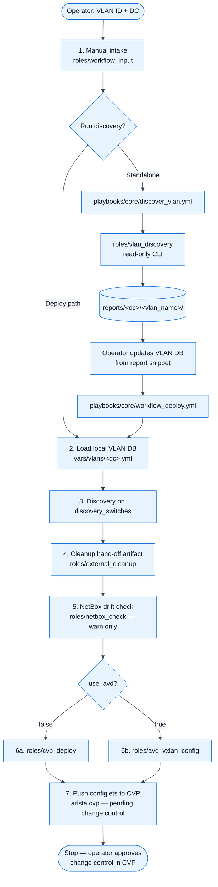
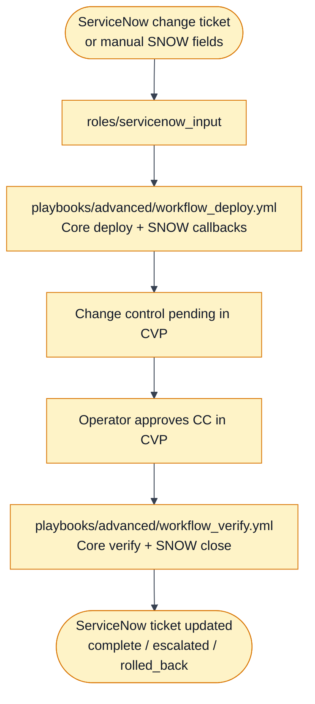

# Workflows — Core vs Advanced

This repository automates **legacy VLAN → VXLAN/EVPN migration** on Arista EOS via CloudVision (CVaaS).
The fabric is **all Arista EOS**, built with **AVD**. BUM is **head-end replication** with EVPN type-3
flood lists; there is no multicast underlay. Loopback0 is the router-id / EVPN peering address and
Loopback1 the VTEP source. NXOS (and parked IOS) switches are the **legacy** source only.
On **`main`**, discovery targets **NXOS** (legacy) and **EOS** (fabric); deploy/verify are **EOS only**.
IOS discovery is parked — see [OS_SUPPORT.md](OS_SUPPORT.md).

Two workflow tiers share the same roles. **Build and harden Core first**, then enable Advanced when ServiceNow integration is ready.

---

## Scope

| In scope (this repo) | Out of scope |
|---|---|
| Read-only VLAN discovery (NXOS + EOS; optional IOS) | Greenfield / new VLAN deployments (separate app) |
| Local per-DC VLAN DB as primary SSOT | NetBox export as part of the migration run |
| Optional service bundles (`vars/services/`) for multi-VLAN cutovers | Executing CVP change control automatically |
| AVD or Jinja → CVP configlet generation | Expanding IOS as a first-class platform on `main` |
| CVP change control creation (pending approval) | Direct device config push |
| Prune apply via `playbooks/core/prune_vlan.yml` (dry-run unless approved) | |
| NXOS→EOS as the supported migration path on `main` | |

Legacy VLAN cleanup is reported during discovery and applied by
`playbooks/core/prune_vlan.yml`. Dry-run is the default. Apply needs
`-e prune_apply=true -e prune_approval=approve`. Default-VRF statics and BGP
are L3 review only, never prune actions.

---

## Core workflow

**Input:** VLAN ID + data center (+ VLAN record in local SSOT for deploy).

**Output:** Discovery reports; CVP configlets in a **pending** change control.

**End state:** Operator approves and executes the change control in CloudVision. The Ansible run stops there.



### Core playbooks

| Playbook | Purpose |
|---|---|
| `playbooks/core/discover_vlan.yml` | Read-only discovery; writes VLAN-centric reports |
| `playbooks/core/workflow_deploy.yml` | Intake → discovery → CVP configlet push (ends at pending CC) |
| `playbooks/core/workflow_verify.yml` | Optional post-approval verification (separate run) |
| `playbooks/core/workflow.yml` | Deploy + verify chained (demo/lab only) |

### Primary SSOT

Per-DC local VLAN databases (one YAML file per VLAN):

- `vars/vlans/lisle/0100_legacy_web.yml`
- `vars/vlans/omaha/0100_legacy_web.yml`

See `vars/vlans/README.md` and `vars/vlans/<dc>/_example.yml` for naming rules.

NetBox is **secondary**. A missing NetBox record logs a warning; the run continues unless `netbox_ssot_required: true`.

### Standalone utilities (not in workflow)

| Playbook | Purpose |
|---|---|
| `playbooks/export_vlan_to_netbox.yml` | Export local VLAN DB attributes to NetBox (dry-run by default) |
| `playbooks/check_netbox.yml` | One-off NetBox VLAN lookup |

---

## Advanced workflow

Wraps Core with ServiceNow at **start** (intake) and **end** (status callbacks).



| Playbook | Purpose |
|---|---|
| `playbooks/advanced/workflow_deploy.yml` | Core deploy + SNOW “pending approval” callback |
| `playbooks/advanced/workflow_verify.yml` | Core verify + SNOW “complete” / escalation |
| `playbooks/advanced/workflow.yml` | Chained deploy + verify (no CVP wait) |

---

## Discovery — what it collects

Per switch, per VLAN (read-only):

| Attribute | Source |
|---|---|
| VLAN + L2 ports | `show vlan id <id>` (Ports column; empty = no access/trunk). EOS MLAG peer ports (`PEt`, `PPo`) are not local; `Vx1` means the VLAN is already VXLAN-mapped |
| Neighbors | `show lldp neighbors detail` (EOS, NXOS) and `show cdp neighbors detail` (NXOS) |
| Port-channel members | EOS `show running-config section channel-group`; NXOS `show running-config \| section channel-group` (neighbors of members are the port-channel's neighbors) |
| Port role | Neighbor first, then interface `description`, then access-vs-trunk. See **Port logic** below |
| Learned MACs | `show mac address-table dynamic vlan <id>` |
| Spanning tree | `show spanning-tree vlan <id>`: root bridge, root port, blocked ports |
| SVI / L3 | `show run interface Vlan<id>`: VRF, primary and secondary IPs, HSRP / VRRP / VARP / anycast, DHCP relay, ACL, PBR, IPv6, OSPF, PIM/IGMP, NAT, uRPF, MTU, shutdown. Unrecognised lines are kept as `other_lines` |
| SVI VRF + ARP | VRF from SVI config; ARP whenever an SVI exists. EOS `show ip arp vrf <vrf> \| include Vlan<id>` (rows for other SVIs are dropped); NXOS `show ip arp vlan <id> vrf <vrf>` |
| SVI ACL contents | `show ip access-lists <name>` for each ACL on the SVI (JSON report) |
| Static routes (EOS + NXOS) | EOS `section ip route`; NXOS `vrf context` + global `ip route`. Exit interface, distance, tag, name, next-hop VRF parsed → **L3 discovery** (shared VRF OK; not prune actions) |
| BGP (EOS + NXOS) | Neighbors (incl. NXOS split stanzas), VLAN EVPN blocks, VRF RD/RT, networks, aggregates, redistribution → **L3 discovery** |
| BGP advertisement | `show ip bgp <prefix> vrf <vrf>` on each SVI owner: in the table, originated here, advertised to which peers |
| Routing policy | EOS `section prefix-list` / `section route-map`; NXOS `show running-config rpm`. Used to evaluate redistribution and peer export for the VLAN prefix |
| OSPF | EOS `section router ospf`; NXOS `show running-config ospf` |
| VXLAN map (EOS) | `show vxlan vlan-to-vni`: VLAN already mapped, VNI collisions |
| Fabric VTEP readiness (EOS) | `show interfaces Vxlan1`: VTEP source and address, replication mode, flood list source, VRF-to-VNI map. Every fabric leaf that will carry the VLAN must be `headend` with an `EVPN` flood list on `vtep_source_interface` (Loopback1); for L3 the gateway VRF must already have an L3 VNI. Anything else is an action item |
| Retain keep-list | Service `prune.retain` or `discovery_prune_retain` → `blocked_by_retain` |

Every critical command that fails, and every switch that never reports back, is listed under **Action items** in the report. A switch missing from discovery is never shown as "VLAN absent".

**Gateway location:** an active SVI (has an IPv4 address, not shut) on a `legacy` switch means the gateway is on the legacy MLS and moves into the fabric (`l3`). No active SVI means the gateway is external (`l2`); ports facing a firewall or router are listed as `external_exits`. Inventory host var `migration_tier` (`legacy` or `fabric`) decides the tier; without it, EOS is `fabric` and everything else `legacy`.

**Port logic:** Empty **Ports** on `show vlan id` means no L2 attachment. Remaining ports are classified from the LLDP/CDP neighbor, then the interface description, then access-vs-trunk:

- **Compute** — servers, IBM Z, Nutanix, UCS, HCI (including compute trunks such as z14 OSA)
- **Network service** — firewall, load balancer, or router. A local endpoint of the VLAN; when there is no SVI it is usually the external gateway. The switch stays participating until the device is re-homed
- **Switch uplink** — links to switches in the inventory (prune candidates)
- **Downstream switch** — a switch outside the inventory. With MACs learned it counts as local endpoints; without, the switch is `review`
- **Peer-link** — EOS MLAG peer (`switchport trunk group mlagpeer`) and NXOS vPC peer-link (exempt)

Discovery reports MACs learned on endpoint-facing links only. Active IP endpoints are ARP entries joined to the edge port where their MAC is learned; the report and `<vlan>_endpoints_<ts>.csv` list them as the test baseline. Prune CLI is a **separate** report: EOS `configure session` + `commit timer` + `configure confirm`; NXOS checkpoint + rollback. Nothing is applied.

**Switch roles (per VLAN):** `VTEP` (Arista leaf with Vxlan1, inventory group `vtep_leaves`), `non-VTEP` (`non_vtep_switches`, or an EOS switch without Vxlan1), and `legacy` MLS (`legacy_mls`; Omaha N7K, Lisle Arista MLAG). UCS fabric interconnects on a leaf are endpoint attachment: that leaf keeps the VLAN. Only VTEPs are participating (VNI targets). A non-VTEP switch with endpoints, or linked to another non-VTEP switch with endpoints, is `l2_attached`: it keeps the VLAN, gets no VNI, and its VTEP uplink makes that VTEP participating. A non-VTEP switch linked to a VTEP and the MLS bridges EVPN and legacy L2; its MLS links become link prunes (see [examples/prune-vlan.md](examples/prune-vlan.md)). An MLS with local endpoints, or that is the only path for a non-VTEP switch, is `legacy_retained`: kept, never a VNI target, never pruned. Peers come from LLDP/CDP, or from an inventory hostname in the port description.

**Human prune plan:** prune-eligible switches get trunk / SVI / VLAN CLI. That set is switches where the VLAN is present, there are no local endpoints, and the VLAN is not protected. Source gateways are in that set, and they are listed first, because they are the root of the legacy L2. Participating leaves and engineer-named gateway leaves are withheld. A source gateway that still has local endpoints stays participating. Default-VRF statics and BGP, and objects in a **shared VRF**, are L3 review only — never prune candidates. Applying that CLI is `playbooks/core/prune_vlan.yml`: dry-run unless `-e prune_apply=true -e prune_approval=approve`. See [examples/prune-vlan.md](examples/prune-vlan.md).

Reports land under:

```text
reports/<dc>/<vlan_slug>/<vlan_slug>_discovery_<timestamp>.md    # short operator report
reports/<dc>/<vlan_slug>/<vlan_slug>_discovery_<timestamp>.yml   # deployable VLAN model
reports/<dc>/<vlan_slug>/<vlan_slug>_discovery_<timestamp>.json  # LLM analysis payload
reports/<dc>/<vlan_slug>/<vlan_slug>_discovery_<timestamp>.csv
reports/<dc>/<vlan_slug>/<vlan_slug>_endpoints_<timestamp>.csv   # endpoint test baseline
reports/<dc>/<vlan_slug>/<vlan_slug>_prune_<timestamp>.{md,json}
reports/<dc>/_prune_plans/<hostname>_prune_plan_<timestamp>.json
```

### Service bundles (optional)

Multi-VLAN / multi-VRF tenant cutovers can declare a service under
`vars/services/<dc>/<service_id>.yml`. See [`vars/services/README.md`](../vars/services/README.md).

Pass `-e manual_service_id=<id>` on discovery to seed VLAN IDs and apply `prune.retain`.

---

## VLAN database schema (per record)

| Field | Required | Notes |
|---|---|---|
| `id` | yes | 802.1Q VLAN ID |
| `name` | yes | Human label; used in report filenames |
| `action` | yes | `migrate` |
| `service_type` | yes | `l2` or `l3` - see [VXLAN_SERVICE_TYPES.md](VXLAN_SERVICE_TYPES.md) |
| `gateway_leafs` | L3 | Fabric leaves that host the gateway. Engineer-supplied; discovery does not infer them |
| `gateway_mode` | L3 | `distributed_anycast` (every participating leaf) or `centralized_anycast` (a leaf pair in `gateway_leafs`). Engineer-supplied |
| `gateway_location` | no | Filled by discovery: `legacy`, `fabric`, `mixed`, or `external` |
| `protected_vlan` | no | When true, no switch is prune-eligible |
| `vni` | yes for migrate | VXLAN network identifier (not inferred by discovery) |
| `vrf` | yes | Target VRF (discovery fills from SVI when present) |
| `target_switches` | yes | Inventory hostnames for CVP config push |
| `discovery_switches` | no | Switches to query; defaults to `target_switches` |
| `vlan_name` | no | On-box / post-migration VLAN name |
| `gateway` | no | Anycast / HSRP / VR address discovered on the SVI |
| `prefixes` | no | Subnets derived from SVI CIDRs |
| `mcast_group` | never | Rejected. BUM is head-end replication with EVPN flood lists |

---

## Typical operator journey (Core)

1. **Discover** an unknown VLAN → share the compute MAC / endpoint view → review the **prune report** (EOS session + timer) → review **L3** before removing the SVI.
2. **Copy the snippet** to `vars/vlans/<dc>/{vid}_{slug}.yml` and complete the VLAN record (VNI is required; confirm VRF, `target_switches`, `service_type`).
3. **Generate overlay config** from that SSOT (`workflow_deploy.yml` with `cvp_apply_configlets=false`), then push when ready.
4. **Approve and execute** the change control in CloudVision.
5. *(Optional)* **Verify** with `workflow_verify.yml` after the change is live.
6. *(Optional)* **Export to NetBox** with `export_vlan_to_netbox.yml` when inventory should reflect the migrated VLAN.

Detailed flags and examples: **[USAGE_GUIDE.md](USAGE_GUIDE.md)**.
